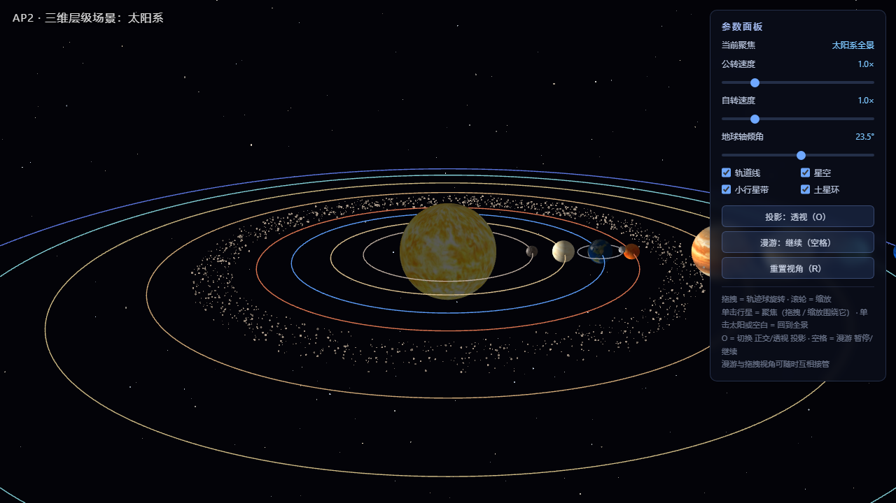
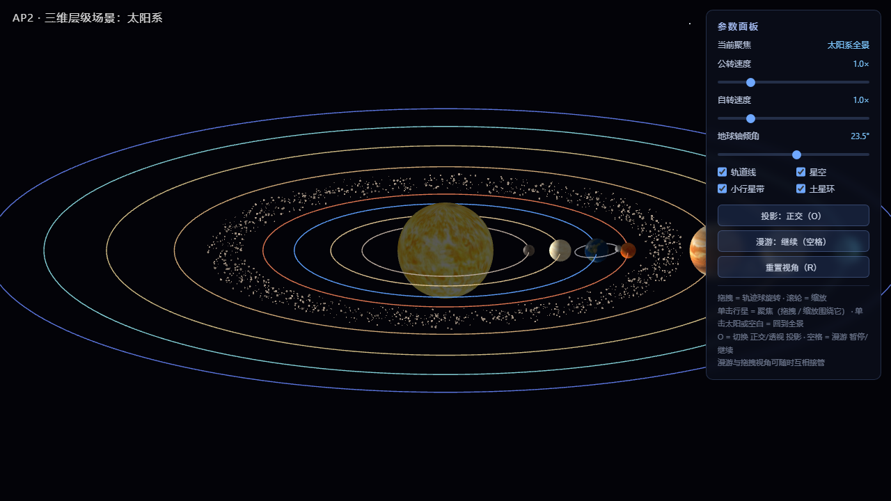

# AP2 · 三维层级场景：太阳系

计算机图形学课程 AP2 作业，用原生 WebGL 2.0 实现。太阳固定在世界原点，八大行星绕日公转，
月球挂在地球的轨道框架下，构成"太阳—地球—月球"的三级变换嵌套。矩阵库是照着教材 MV.js
的接口自己写的一份（`js/MV.js`，`mult` / `rotate` / `translate` / `lookAt` / `perspective`
/ `ortho` 等函数签名与教材一致），没有使用 three.js 之类的封装库。

必做部分六项全部完成。选做做了 E1（完整太阳系、土星环、小行星带）和 E3（虚拟轨迹球），
E2（日食/月食）没有来得及做。

## 1. 运行方法

双击 index.html 用浏览器打开即可运行，不需要启动本地服务器。所有纹理已经转成 base64
内嵌在 `js/textures-embedded.js` 里。

这里记录一个我调试时踩过的坑：最初的版本纹理是按相对路径 `textures/xxx.jpg` 加载的，
通过 http 服务器访问一切正常，但直接双击打开（file:// 协议）时贴图全部失效，
所有天体变成灰球。后来查资料才知道是浏览器的安全策略：file:// 页面里 Image 对象
加载本地文件后向 WebGL 上传像素会被拦截。把纹理全部 base64 内嵌进 JS 之后，
两种打开方式就都正常了。另外 `js/config.js` 里给每个天体配了一个纯色兜底纹理，
就算贴图真的加载失败，行星也会各自显示默认颜色，而不是统一的灰色。

用服务器打开当然也可以：

```
python -m http.server 8000
# 浏览器访问 http://localhost:8000/
```

在线地址（GitHub Pages）：`https://<用户名>.github.io/<仓库名>/`

## 2. 操作说明

| 操作 | 功能 |
|---|---|
| 鼠标拖拽 | 旋转视角（虚拟轨迹球，选做 E3） |
| 滚轮 | 缩放 |
| `O` | 切换 透视 / 正交 投影 |
| `空格` | 漫游动画 暂停 / 继续 |
| `R` | 重置视角 |
| 单击某行星 | 聚焦该行星（视角围绕它旋转、可推近观察，并跟随它公转） |
| 单击太阳或空白处 | 取消聚焦，回到太阳系全景 |
| 面板滑条 | 公转速度、自转速度（0–5×）、地球轴倾角（0–45°） |
| 面板开关 | 轨道线 / 星空 / 小行星带 / 土星环 显示切换 |

单击聚焦的实现是把每个天体的中心用当前投影矩阵投到屏幕上，点击位置落在其投影像
（半径加 14px 容差）内即命中，这是教材里拾取思想的简化版。聚焦之后用户视角变成
`V = T(0,0,-dist) · R_trackball · T(-target)`，相机围绕目标天体转；目标位置每帧
从上一帧的模型矩阵取平移分量，所以视角会跟着行星一起绕太阳走。滚轮的最近距离
也随聚焦目标动态放宽，可以把行星推到占满画面。漫游播放过程中，任意时刻都可以
按住鼠标拖拽或滚动滚轮，视角会从漫游当前所在的画面直接被接管，不发生跳变；
之后再按空格，相机在约 1 秒内平滑过渡回漫游路径继续飞行。

## 3. 层级结构：变换嵌套树

所有天体的模型矩阵按父子层级逐层相乘得到。本项目约定 `mult(A, B) = A·B`，
顶点写成列向量 `v' = M·v`，所以乘在最右边的矩阵先作用于顶点。

```
world（世界原点 = 太阳中心，点光源）
│
├── 太阳
│     M_sun = R_y(自转角) · S(r_sun)
│
├── 行星轨道框架（每个行星一个，公转平面 = 黄道面 XZ）
│     M_orbit(p) = R_y(公转角θ) · T(d_p, 0, 0)
│     │
│     ├── 行星本体（顺序：先倾角，后自转）
│     │     M_p = M_orbit · R_z(轴倾角) · R_y(自转角φ) · S(r_p)
│     │
│     └── （土星）行星环
│           M_ring = M_orbit · R_z(轴倾角) · S(r_p)     （随行星倾角一起倾斜）
│
└── 地球的月球轨道框架（第三级，手工构造矩阵）
      M_moonTrack = R_z(5.145°) · R_y(公转角θ_m) · T(d_moon, 0, 0)
      │
      └── 月球（潮汐锁定：自转角 = 公转角）
            M_moon = M_orbit(earth) · M_moonTrack · R_y(θ_m) · S(r_moon)
```

几点说明：

1. 地球的局部矩阵写作 `R_z(tilt) · R_y(spin)`，构造时先乘倾角、再乘自转，
   作用到顶点时自转先发生、再被整体倾斜。这样自转轴保持固定的倾斜指向（23.5°），
   地球绕自身倾斜的轴自转，和真实情况一致。如果把顺序写成 `R_y(spin) · R_z(tilt)`，
   自转轴会绕竖直方向打转。这是这个作业最容易出错的地方，我写代码之前先在纸上
   把顶点的变换顺序推了一遍才动手。
2. 月球挂在"地球轨道框架" `M_orbit(earth)` 下面，而不是挂在地球本体矩阵下面。
   `M_orbit` 只包含公转的旋转和平移，不含地球的自转和倾角，所以月球不会跟着地球
   自转一起打转。月球的轨道面又通过手工矩阵 `R_z(5.145°)` 相对黄道面倾斜，
   最终月球在世界坐标里的轨迹是"倾斜的小圆 + 绕日的大圆"复合出来的曲线。
3. 月球潮汐锁定：自转角直接取公转角（`R_y(θ_m)` 复用），始终以同一面朝向地球。
4. 金星（-243 天）和天王星（-0.718 天）是逆行自转（负周期），天王星轴倾角 97.77°
   （近似"躺着"转），都按真实参数写在 config.js 里。

## 4. 手动矩阵的构造说明（对应教材 Ch4）

作业要求至少一处运动不使用封装好的复合函数，而用 MV.js 的基本变换手工构造再用
`mult` 组合。我选的实现对象是月球轨道面倾角，代码在 `js/main.js` 的
`manualRotateZ()` 和 `moonMatrix()` 两个函数里。

### 4.1 绕 Z 轴旋转矩阵的展开

三维仿射变换用 4×4 齐次坐标矩阵表示。绕 Z 轴旋转角度 α 时，三个基向量分别变为
`e_x → (cosα, sinα, 0)`、`e_y → (−sinα, cosα, 0)`、`e_z → e_z`，平移分量不变：

```
        ⎡ cosα  −sinα  0  0 ⎤
Rz(α) = ⎢ sinα   cosα  0  0 ⎥
        ⎢  0      0    1  0 ⎥
        ⎣  0      0    0  1 ⎦
```

代码里不调用任何封装函数，16 个元素逐个写出（WebGL 是列主序存储，
第 k 列就是 R 作用在第 k 个基向量上的结果）：

```js
function manualRotateZ(deg) {
  const a = radians(deg), c = Math.cos(a), s = Math.sin(a);
  return [
    c, s, 0, 0,     // 第 0 列：R·e_x = (c, s, 0)
    -s, c, 0, 0,    // 第 1 列：R·e_y = (-s, c, 0)
    0, 0, 1, 0,     // 第 2 列：R·e_z = e_z
    0, 0, 0, 1,     // 第 3 列：齐次平移分量（纯旋转为 0）
  ];
}
```

### 4.2 用基本变换组合出月球轨道框架

月球轨道框架由三个基本变换用 `mult` 逐项组合而成（`moonMatrix()`）：

```js
let M_track = manualRotateZ(5.145);               // ① 轨道面倾角（手工矩阵）
M_track = mult(M_track, rotate(θ_m, 0, 1, 0));    // ② 在倾斜后的平面内绕地球公转
M_track = mult(M_track, translate(d_moon, 0, 0)); // ③ 平移到轨道半径处
```

即 `M_track = Rz(5.145°) · Ry(θ_m) · T(d, 0, 0)`。作用到月球顶点时，
顺序是：先平移到轨道位置，再绕（已经被倾斜过的）y 轴公转，最后整个轨道面绕 z 轴
倾斜 5.145°。这个框架再右乘地球的轨道框架 `M_orbit(earth)`，月球就跟着地球
一起绕太阳公转了。

`Rz` 必须写在最左边（最后作用于顶点），这样轨道面相对黄道面的 5.145° 倾角才是
固定的；如果写成 `Ry · Rz`，倾斜轴会跟着公转角一起转，轨道面就绕着地轴晃，
物理意义完全不对。这就是教材 Ch4 里强调的矩阵乘法不可交换性。

月球的轨道线也是用同一个手工矩阵画的（`render()` 里调用
`manualRotateZ(CONFIG.moon.inclinationDeg)`），保证轨道线和月球严格共面。

## 5. 纹理与 UNPACK_FLIP_Y_WEBGL

太阳、地球、月球和八大行星各贴一张位图纹理（`gl.texImage2D` 上传，
顶点带纹理坐标 attribute），土星环是程序化生成的 RGBA 径向条纹纹理。

上下颠倒是写纹理时实际碰到的问题：图片文件的像素行序是自上而下的
（第 0 行是图像顶部），而 OpenGL 的纹理坐标约定 `v = 0` 在底部、`v = 1` 在顶部。
直接上传的话，图像顶部会落在 `v = 0`，也就是球的南极——第一次跑起来时
地球的北极冰盖跑到了南极，整个南北半球是反的。解决办法是上传前设置：

```js
gl.pixelStorei(gl.UNPACK_FLIP_Y_WEBGL, true);  // 上传时垂直翻转像素行序
```

翻转后图像顶部对应 `v = 1`，再配合球体 UV 生成时让北极取 `v = 1`
（`shapes.js` 的 `createSphere`），贴图方向就正确了。其实还有一个等价做法是
不翻像素、在几何 UV 里用 `v' = 1 − v`，两种方式选一种就行。

另外两个纹理方面的细节：

- 所有位图统一重采样到 1024×512（2 的幂）。WebGL 1.0 对非 2 次幂纹理有限制，
  只能 CLAMP_TO_EDGE 且不能生成 mipmap；虽然 WebGL 2.0 已经放开了这个限制，
  但为了兼容回退到 WebGL 1.0 的旧环境，仍然统一重采样了；
- 经度方向设 `TEXTURE_WRAP_S = REPEAT`，贴图水平无缝环绕球面。

## 6. 双投影对比（按 O 切换）

同一画面下按 `O` 在透视、正交之间切换。有一个细节：如果两种投影各用各的默认取景框，
切换时画面大小会跳变，没法对比。所以正交投影的取景框是按当前相机距离匹配的
（`halfH = dist · tan(fovy/2)`），保证两种投影看到的是同一取景范围，
差异只来自投影方式本身。

| 透视投影（默认） | 正交投影（按 O） |
|---|---|
|  |  |

差异说明：

- 透视投影按 `perspective(45°, aspect, 0.1, 1500)` 定义视锥体，保持"近大远小"：
  近处的行星明显比远处的大，轨道线向远处收缩、相互汇聚，有纵深感；
- 正交投影按 `ortho(-w, w, -h, h, 0.1, 1500)` 定义长方体视景体，投影线彼此平行，
  同样大小的物体无论远近屏幕上一样大，轨道线不再汇聚，画面看起来像工程俯视图，
  立体感消失。

对比两张截图可以看到：透视图中近侧的轨道弧张开更大、行星盘面更大；
正交图中各行星的盘面大小只由半径决定，和距离无关。

## 7. 相机漫游

- 预设路径：8 个关键帧（相机位置）绕场景一周，高度有起伏
  （`CONFIG.camera.roamKeyframes`），用 Catmull-Rom 样条插值——选它是
  因为曲线正好过关键帧，而且插值只需要相邻的几个点，实现简单。视线始终看向太阳，
  绕一圈约 48 秒；
- `空格` 暂停 / 继续；
- 漫游和拖拽互相接管的实现：用户视角恒等于 `V = T(0,0,-dist) · R_trackball`，
  漫游视角是 `lookAt(eye(t), origin, up)`。由 `lookAt(eye, at, up)` 可以分解出
  `T(0,0,-dist) · R_l`，接管时直接取 `R_trackball = R_l`、`dist = |eye − at|`，
  不需要做任何拟合，所以视角是逐帧连续的，没有跳变。

漫游录屏（10 秒）：`screenshots/roam.gif`。演示时也可以现场按空格暂停/继续。

## 8. 参数面板

- 公转速度 / 自转速度滑条（0–5×）：分别累计到 `simYears` 和 `spinClock` 两个
  独立时钟里，拖动立即生效，不打断当前角度；
- 地球轴倾角滑条（0–45°）：直接改写地球局部矩阵里的 `R_z(tilt)`，
  可以实时观察"先倾角后自转"的轴指向变化；
- 轨道线 / 星空 / 小行星带 / 土星环 显示开关。

## 9. 选做扩展

- **E1 完整太阳系**：8 颗行星，半径、距离、公转/自转周期、轴倾角按真实比例配置
  （金星、天王星逆行自转）；土星环用程序化生成的 RGBA 径向条纹纹理，开了 α 混合
  和双面渲染，随 26.73° 轴倾角倾斜；小行星带在火星和木星之间，1600 个点精灵，
  各自按不同的周期独立公转。实现集中在 `config.js` 和 `main.js`。
- **E3 虚拟轨迹球**：按教材的 Virtual Trackball 实现（`js/trackball.js`）。
  鼠标位置归一化到 `[-1,1]²`，单位圆内投影到上半球 `z = √(1−x²−y²)`，
  圆外钳制到赤道；一次拖拽取两个采样点 p1、p2，旋转轴取 `p1×p2`、旋转角取
  `arccos(p1·p2)`；增量旋转左乘累积旋转 `R ← RΔ·R`。这样任意姿态下拖拽，
  手感都像直接抓住球面在转。
- E2 日食/月食：未实现。

## 10. 代码结构与参数集中配置

```
AP2/
├── index.html        入口 + 参数面板 DOM
├── css/style.css     UI 样式
├── js/
│   ├── MV.js         4×4 齐次矩阵/向量库（mult/rotate/translate/lookAt/perspective/ortho…）
│   ├── config.js     全部天体参数集中配置（半径/距离/周期/倾角/纹理/相机/时间压缩）
│   ├── shapes.js     球体 / 环面 / 圆（轨道线）几何生成
│   ├── trackball.js  虚拟轨迹球（E3）
│   ├── textures-embedded.js  base64 内嵌纹理（file:// 直开也能正常贴图）
│   └── main.js       场景图、手工矩阵、双投影、漫游相机、渲染循环、UI 绑定
├── textures/         10 张天体位图纹理
└── screenshots/      双投影对比截图、漫游录屏
```

所有天体参数（半径、轨道距离、公转周期、自转周期、轴倾角、纹理路径、颜色）
集中在 `js/config.js` 的 `CONFIG` 对象里，改任何一个参数都不用动渲染代码。

## 附：独立完成说明

本项目代码全部独立完成，未引用他人或教程的代码；`js/MV.js`、着色器初始化等
工具部分按教材配套库（Common/ 下 `MV.js` / `initShaders.js`）的接口自行实现。
全部纹理图片由本人使用 AI 图像生成工具制作，并统一做了等距圆柱投影与
分辨率（2 的幂）处理。
